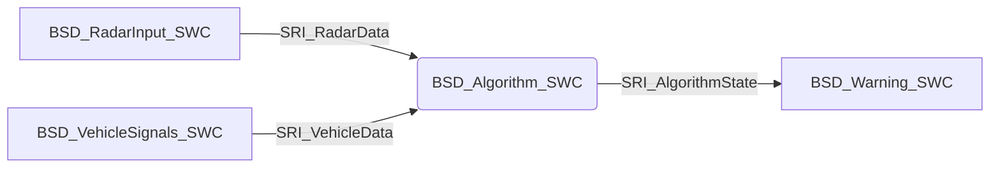

# 5_PRJ-002 / SWC-05: BSD_Algorithm_SWC

**Document ID:** SRS-PRJ-002-ALG

**Version:** 1.0

**Date:** 2026-10-07

**Status:** Draft

**Classification:** Personal Portfolio Project

**Author:** Abdallah Mohamed Sedik

**Parent Document:** SRS-PRJ-002 (Blind Spot Detection)

---

## 1. Introduction

### 1.1 Purpose

This document specifies the software requirements for the `BSD_Algorithm_SWC`. The SWC represents the core application logic of the Blind Spot Detection system. It evaluates validated radar distances and vehicle states (speed, turn signal) to determine the BSD state (CLEAR, WARNING, ALERT) for both the left and right sides.

### 1.2 Scope

`BSD_Algorithm_SWC` is responsible for:

* Reading validated `Distance` and `Status` from `BSD_RadarInput_SWC` for both left and right channels.
* Reading `Vehicle_Speed`, `TurnSignal`, and their respective statuses from `BSD_VehicleSignals_SWC`.
* Implementing the CLEAR / WARNING / ALERT state machine for each side independently.
* Implementing highway-speed suppression logic (ignoring radar inputs above a certain speed threshold).
* Publishing the final `BSD_State_Left` and `BSD_State_Right` to the `BSD_Warning_SWC`.

The following are out of scope:

* Raw signal validation and scaling.
* CAN reception/transmission.
* LED control and DTC reporting.

### 1.3 Definitions, Acronyms, and Abbreviations

| Term | Definition |
| --- | --- |
| **BSD** | Blind Spot Detection |
| **SWC** | Software Component |
| **Highway Suppression** | Disabling BSD warnings when vehicle speed exceeds a defined threshold |
| **BSDState_T** | Enumeration describing the blind spot warning state |

### 1.4 References

* SRS-PRJ-002: Software Requirements Specification, Blind Spot Detection (BSD)
* AUTOSAR Classic Platform: Software Component Template Specifications

---

## 2. SWC Overview

### 2.1 Position in the Architecture

### 2.2 Interfaces Summary

| Direction | Interface | Data Element | Type |
| --- | --- | --- | --- |
| Input | SRI_RadarData | `Distance` (Left/Right) | `float32` |
| Input | SRI_RadarData | `Status` (Left/Right) | `RadarStatus_T` |
| Input | SRI_VehicleData | `Vehicle_Speed`, `Speed_Status` | `float32`, `SignalStatus_T` |
| Input | SRI_VehicleData | `TurnSignal`, `TurnSignal_Status` | `TurnSignal_T`, `SignalStatus_T` |
| Output | SRI_AlgorithmState | `BSD_State_Left` | `BSDState_T` |
| Output | SRI_AlgorithmState | `BSD_State_Right` | `BSDState_T` |

### 2.3 Runnable

| Runnable | Trigger | Period |
| --- | --- | --- |
| RE_Algorithm_Run | Timing event | 20 ms |

---

## 3. Data Types

### 3.1 Enumerations

*(All enumerations use `uint8` as the underlying type. Boolean types shall not be used.)*

**BSDState_T**

| Enumerator | Value | Meaning |
| --- | --- | --- |
| `BSD_CLEAR` | 0 | No object in blind spot |
| `BSD_WARNING` | 1 | Object in blind spot, warning active |
| `BSD_ALERT` | 2 | Object in blind spot, collision imminent |

---

## 4. Functional Requirements

| ID | Requirement | Priority |
| --- | --- | --- |
| ALG-FR-01 | The SWC shall read radar distances, statuses, vehicle speed, and turn signal states every execution cycle | High |
| ALG-FR-02 | The SWC shall process the left and right blind spot zones independently | High |
| ALG-FR-03 | The SWC shall treat radar distance as invalid (object not detected) if `Status` is `RADAR_FAIL` | High |
| ALG-FR-04 | The SWC shall transition the state from `BSD_CLEAR` to `BSD_WARNING` when object distance < 3.0 m | High |
| ALG-FR-05 | The SWC shall transition the state from `BSD_WARNING` to `BSD_CLEAR` when object distance ≥ 3.0 m | High |
| ALG-FR-06 | The SWC shall transition the state to `BSD_ALERT` when the state is `BSD_WARNING` AND the turn signal is active on the same side | Critical |
| ALG-FR-07 | The SWC shall transition the state from `BSD_ALERT` to `BSD_WARNING` when the turn signal is deactivated | High |
| ALG-FR-08 | The SWC shall force the state to `BSD_CLEAR` if vehicle speed exceeds the `VSPD_SUPPRESSION_THRESHOLD` (Highway suppression) | Medium |
| ALG-FR-09 | The SWC shall force the state to `BSD_CLEAR` if `Speed_Status` is `SIGNAL_FAIL` (fail-safe behavior) | High |
| ALG-FR-10 | The SWC shall execute every 20 ms | High |
| ALG-FR-11 | The SWC shall not use boolean types; all states shall be `BSDState_T` | High |

---

## 5. Logic and Configuration

### 5.1 State Transition Table (per side)

| Current State | Condition | Next State |
| --- | --- | --- |
| `CLEAR` | Distance < 3.0m & Speed < Suppression | `WARNING` |
| `WARNING` | Turn Signal Active (Same Side) | `ALERT` |
| `WARNING` | Distance ≥ 3.0m | `CLEAR` |
| `ALERT` | Turn Signal Deactivated | `WARNING` |
| `ALERT` | Distance ≥ 3.0m | `CLEAR` |
| *Any* | Speed > Suppression OR Speed invalid | `CLEAR` |

### 5.2 Configuration Parameters

| Parameter | Description | Value |
| --- | --- | --- |
| `BSD_WARN_DISTANCE_M` | Distance threshold for warning | 3.0 |
| `VSPD_SUPPRESSION_THRESHOLD` | Speed limit to disable BSD | 100.0 (km/h) |

---

## 6. Non-Functional Requirements

| ID | Requirement | Priority |
| --- | --- | --- |
| ALG-NFR-01 | The SWC shall not use dynamic memory allocation | High |
| ALG-NFR-02 | The SWC code shall comply with MISRA C:2012 | High |
| ALG-NFR-03 | Execution jitter shall not exceed ±2 ms | High |

---

## 7. Port Specification

| Port | Type | Interface | Access Mode |
| --- | --- | --- | --- |
| RPort_RadarDataLeft | Receiver | SRI_RadarData | Implicit receive |
| RPort_RadarDataRight | Receiver | SRI_RadarData | Implicit receive |
| RPort_VehicleData | Receiver | SRI_VehicleData | Implicit receive |
| PPort_AlgorithmState | Sender | SRI_AlgorithmState | Implicit send |